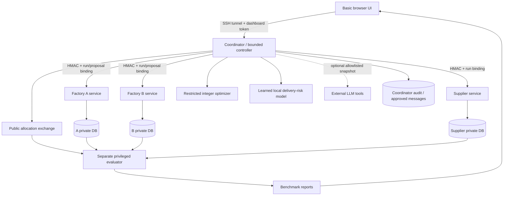

# Architecture and trust boundaries

On LinuxONE each service has a separate unprivileged Linux user. Factory directories are readable by their owner and the privileged evaluator group. Their configuration/HMAC keys are owner-only. The coordinator has participant endpoints/verification keys, never participant database paths or read permissions. Factory B has only its own shared HMAC key and cannot authenticate as A/coordinator to A's API.

The evaluator has an explicit research privilege to read synthetic participant databases. It reads the coordinator's allocation exchange directory and writes benchmark-only reports. The coordinator can read the report directory, but OS permissions prevent it from writing those reports. These aggregates are extra disclosures to the privileged dashboard viewer; the model snapshot builder never includes them.

Local development has separate processes but one OS user. It demonstrates API/data-flow boundaries, not filesystem protection. The UI labels this accurately. Root and VM administrators remain trusted even with separate Linux service users. Published fixture values are intentionally synthetic and known for reproducibility; random private sentinel values test the actual runtime data path.

## AI feature

The learned logistic regression predicts historical retail line-item delay risk using shipping mode, scheduled days and market. Predictions prioritize which factory is validated first. Controller actions and all constraints remain deterministic. Model inference and optimization execute locally on LinuxONE. Shipping contexts are public illustrative choices, and transferring retail predictions to chip procurement is not validated.

The optional LLM coordinator receives only bid signals, supply offers, current allocation, approved feedback and public shipping contexts. Tools accept proposal IDs, not arbitrary quantities. State checks prevent premature finalization, invented floors, unauthorized tools and more than two solves. The application produces grounded summaries from observed results; it never asks for hidden model reasoning.

## Authentication and audit

- Requests and responses use independent signed envelopes with exact method/path/sender/recipient/run binding, a 90-second timestamp window, random nonce and persistent replay checks.
- Feedback is bound to an exact proposal and participant; stale rounds/scenario switches are rejected.
- Dashboard access uses a generated bearer token. Same-origin browser checks and strict loopback Host validation protect the SSH/local demo; there is no public remote login flow.
- HMAC means shared-key message authentication, not encryption, nonrepudiation or truthfulness.
- Audit events chain SHA-256 digests and authenticate each digest with a separate audit HMAC key. `verify-audit --anchor DIGEST` checks an externally retained anchor. Without an external anchor, a privileged key holder can rewrite/truncate a locally consistent chain.
- Transport to external model APIs uses HTTPS; participants communicate on the trusted host's loopback. No claim of protection from malicious host administrators or hardware-backed execution is made.

